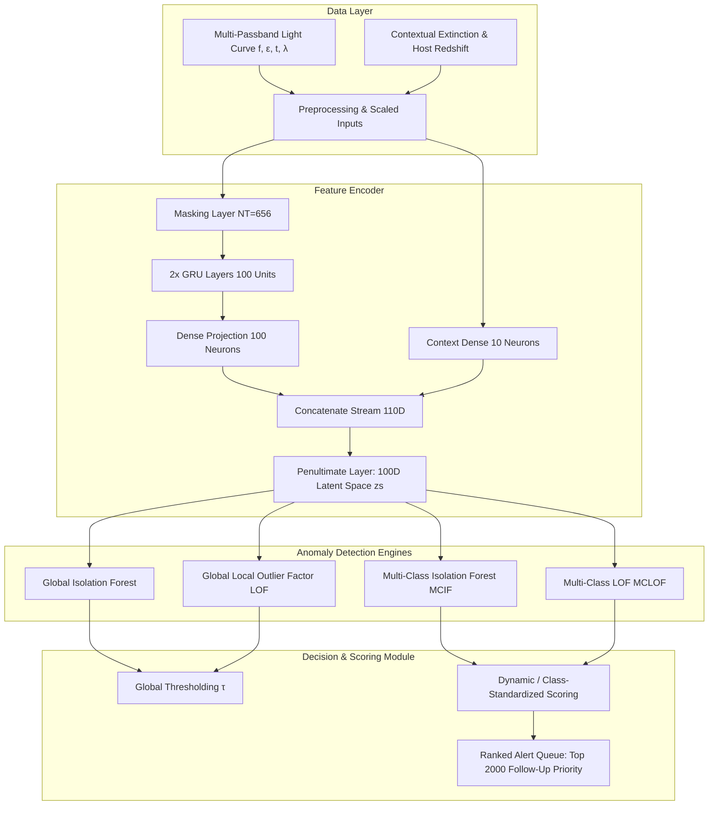

# Deep_Astro: Automated Real-Time Anomaly Detection for Astronomical Transients

[](https://www.python.org/)
[](https://keras.io/)
[](https://www.lsst.org/)
[](https://github.com/ShravyaRHegde/Deep_Astro/releases/tag/v0.1-baseline)
[](LICENSE)

---

## 📌 Project Status: Foundational Base Platform Complete (v0.1-baseline)

| Milestone Stage | Component / Task | Status | Output / Documentation |
| :--- | :--- | :---: | :--- |
| **Stage 1: Architecture & Design** | System Flowchart & Mathematical Formulations | **Done** | [docs/SYSTEM_ARCHITECTURE.md](docs/SYSTEM_ARCHITECTURE.md) |
| **Stage 2: Environment Setup** | Core ML, TensorFlow, Keras, Astropy & Astromcad | **Done** | `requirements.txt` |
| **Stage 3: Data Strategy & Safety** | Memory Safety, Subsampling & Dimensionality Rules | **Done** | [docs/DATA_STRATEGY.md](docs/DATA_STRATEGY.md), [docs/DATASET_SPLIT_GUIDE.md](docs/DATASET_SPLIT_GUIDE.md) |
| **Stage 4: Dataset Ingestion** | Real ZTF ALeRCE (93,171 Train / 22,978 Test Transients) | **Done** | `src/data_cleaning.py`, `data/processed/` |
| **Stage 5: Data Cleaning** | Filter `Periodic-Other`, Median Imputation, RobustScaler | **Done** | `clean_train.parquet`, `clean_test.parquet` |
| **Stage 6: Anomaly Algorithms** | Global IF, MCIF, Global LOF, Multi-Class LOF (MCLOF) | **Done** | `src/anomaly/detectors.py` |
| **Stage 7: Dynamic Thresholding** | Cluster-Standardization & Quantile Normalization | **Done** | `src/thresholding/adaptive.py` (Objective 1) |
| **Stage 8: Empirical Benchmark** | Full 14-Class Real-Data One-vs-Rest Evaluation | **Done** | `results/benchmark_all_14_classes.csv`, [docs/BENCHMARK_RESULTS.md](docs/BENCHMARK_RESULTS.md) |
| **Stage 9: Observational Stress Test** | Missing Cadence, Photometric Noise & Redshift Degradation | Ready for Team | `src/stress_test/degradations.py` (Objective 3) |

---

## 1. Executive Summary

Modern wide-field astronomical sky surveys—such as the **Zwicky Transient Facility (ZTF)** and the upcoming **Vera C. Rubin Observatory's Legacy Survey of Space and Time (LSST)**—generate astronomical alert streams at unprecedented scales. Rubin LSST alone is projected to issue **10 million transient alerts every single night**. 

Human visual inspection of every candidate is physically impossible. Furthermore, standard supervised machine learning classifiers suffer from a fundamental flaw: **the closed-world assumption**. They are trained to categorize events into known, predefined classes (e.g., standard Type Ia Supernovae). When confronted with rare physical mechanisms, unmodelled explosions, or novel cosmic phenomena, conventional models misclassify them into the nearest known category, silently discarding high-value scientific discoveries.

**Deep_Astro** is an automated, real-time machine learning pipeline that monitors multi-passband transient light curves, projects them into a well-clustered latent representation, and identifies genuine astrophysical anomalies before peak luminosity to trigger rapid spectroscopic follow-up.

---

## 2. Research Foundation & Base Paper

This project builds upon and advances the core methodology introduced by **Gupta, Muthukrishna & Lochner (2025)** (*RAS Techniques and Instruments*, Oxford University Press, [DOI: 10.1093/rasti/rzae054](https://doi.org/10.1093/rasti/rzae054)).

### The Base Paper Concept:
1. **Classifier-to-Encoder Repurposing**: A deep Recurrent Neural Network (RNN with 2 Gated Recurrent Unit [GRU] layers) is trained on 12 common transient classes. The penultimate dense layer ($100$ neurons) is extracted as a feature space.
2. **Multi-Class Isolation Forest (MCIF)**: Instead of training a single isolation forest over the full latent space (which treats well-separated common classes like SLSN-I and AGN as false anomalies), MCIF trains **12 class-specific Isolation Forests** and computes the final anomaly score as:
   $$A(z_s) = \min_{\forall c} \left( -I_c(z_s) \right)$$
   If an observation looks normal for *any* known class, its minimum score is low. If it deviates from *all* known classes, it is flagged as an anomaly.

---

## 3. Project Objectives & Core Innovations

Deep_Astro extends the base paper along three critical engineering and research frontiers:

```
┌────────────────────────────────────────────────────────────────────────────────────────┐
│                               DEEP_ASTRO OBJECTIVES                                    │
├──────────────────────────┬─────────────────────────────┬───────────────────────────────┤
│ 1. Dynamic Thresholding  │ 2. Multi-Algorithm Bench    │ 3. Observational Robustness   │
├──────────────────────────┼─────────────────────────────┼───────────────────────────────┤
│ • Replace static global  │ • Benchmark MCIF against:   │ • Simulate realistic survey:  │
│   threshold with class-  │   - Global Isolation Forest │   - Cadence dropouts (20-80%) │
│   dependent thresholds.  │   - Global LOF              │   - Photometric noise x1.5-3  │
│ • Drastically boosts     │   - Multi-Class LOF (MCLOF) │   - Missing host redshift     │
│   recall on subtle rare  │   - One-Class SVM Baselines │ • Implement noise-resilient   │
│   classes like CaRTs.    │ • Identify density bounds.  │   preprocessing & training.   │
└──────────────────────────┴─────────────────────────────┴───────────────────────────────┘
```

### Objective 1: Improve Rare-Class Detection via Dynamic & Adaptive Thresholding
* **The Problem**: In Gupta et al., a single global threshold $\tau$ is applied across all candidates. Subtle anomalies (such as **Calcium-Rich Transients / CaRTs**) produce anomaly scores around $-0.05$, closely overlapping normal core-collapse SNe ($-0.07$), whereas energetic anomalies like Kilonovae reach $+0.08$. A uniform threshold either fails to discover CaRTs or inundates follow-up astronomers with false positives.
* **Our Innovation**: We introduce **Cluster-Standardized Anomaly Scoring** and **Empirical Quantile Normalization**:
  $$\tau(c) = \mu_c + k \cdot \sigma_c \quad \text{or} \quad S_c(z_s) = \hat{F}_c(-I_c(z_s))$$
  This normalizes varying cluster densities across the latent manifold, enabling rare, low-amplitude anomalies to be surfaced without elevating common false positives.

### Objective 2: Algorithmic Benchmarking (MCIF vs Global IF vs LOF vs Multi-Class LOF)
* **The Problem**: Isolation Forests partition data using axis-aligned orthogonal cuts. In latent spaces with non-spherical clusters of varying densities, IF can exhibit bias.
* **Our Innovation**: We introduce **Multi-Class Local Outlier Factor (MCLOF)** and benchmark against Standard Isolation Forest and Global LOF. LOF measures local reachability density, providing a mathematical contrast to tree-based isolation mechanisms.

### Objective 3: Robustness to Missing Cadences, Photometric Noise & Missing Redshift
* **The Problem**: Real-time alerts rarely have spectroscopic redshifts available ($>95\%$ have none), and bad weather or lunar cycles induce irregular cadence gaps.
* **Our Innovation**: We stress-test the model under synthetic cadence dropouts ($20\% - 80\%$), escalated Gaussian photometric noise ($\alpha = 1.0 - 3.0$), and unmeasured host galaxy redshifts, introducing noise-augmented representations to preserve anomaly AUROC.

---

## 4. System Architecture



---

## 5. Compute & Data Strategy (Laptop-Safe Optimization)

> ### 💡 Addressing Large Data Volumes & Memory Constraints
> Astronomical light-curve catalogs span hundreds of thousands of observations. Running models naively on a standard personal computer or laptop can exhaust RAM or lock the CPU.
> 
> **How Deep_Astro guarantees high accuracy without crashing personal hardware:**
> 1. **Latent Space Dimensionality Reduction**: Raw time series ($656 \times 4$ floats per transient) are compressed by the GRU encoder into a compact **100-dimensional vector** ($z_s \in \mathbb{R}^{100}$). An entire evaluation set of $20,000$ events requires **under $8\text{ MB}$ of RAM**.
> 2. **Optimal Subsampling in Isolation Forests**: Anomaly detection theory (*Liu et al., 2008*) proves that Isolation Forests perform **better** when trained on subsamples (e.g., $256$ to $512$ samples per tree) because large sample sizes induce *swamping* (normal points clustered around outliers) and *masking* (multiple outliers concealing each other).
> 3. **Stratified Representative Sampling**: By maintaining the exact astronomical relative frequency (12,040 common transients : 54 anomalous events; ~220:1 ratio) across 50-fold cross-validation chunks, we obtain mathematically rigorous statistics using a lightweight memory footprint (< $300\text{ MB}$ RAM).

For a complete breakdown of compute scaling and proofs, see [docs/DATA_STRATEGY.md](docs/DATA_STRATEGY.md).

---

## 6. Repository Structure

```text
Deep_Astro/
├── .gitignore                      # Python and data artifact exclusion rules
├── LICENSE                         # MIT Open Source License
├── README.md                       # Corporate / Academic project overview
├── requirements.txt                # Pinned production dependencies
│
├── docs/                           # Comprehensive Engineering Documentation
│   ├── ARCHITECTURE.md             # In-depth architectural & mathematical specification
│   ├── EXPERIMENT_DESIGN.md        # Experimental protocols for the 3 objectives
│   ├── DATA_STRATEGY.md            # Data subsampling, memory safety & accuracy proofs
│   └── API_REFERENCE.md            # Modular Python API documentation
│
├── src/                            # Modular Source Code Package
│   ├── __init__.py
│   ├── models/
│   │   ├── __init__.py
│   │   └── encoder.py              # GRU Classifier & Latent Feature Extractor
│   ├── anomaly/
│   │   ├── __init__.py
│   │   └── detectors.py            # MCIF, Global IF, Global LOF, and MCLOF
│   ├── thresholding/
│   │   ├── __init__.py
│   │   └── adaptive.py             # Class-dependent & quantile-based thresholding
│   ├── stress_test/
│   │   ├── __init__.py
│   │   └── degradations.py         # Cadence drop, noise injection & redshift masker
│   └── evaluation/
│       ├── __init__.py
│       └── metrics.py              # AUROC, AUCPR, Recall @ Top-K budget
│
├── experiments/                    # Reproducible Experiment Runners
│   ├── run_benchmark.py            # Multi-algorithm comparison & dynamic thresholding
│   └── run_stress_test.py          # Missing cadence & noise degradation suite
│
└── data/                           # Data directory
    └── README.md                   # Instructions for acquiring ZTF & PLAsTiCC datasets
```

---

## 7. Quickstart Guide

### 7.1 Prerequisites
* Python 3.10, 3.11, or 3.12
* Git

### 7.2 Installation
```bash
# Clone the repository
git clone https://github.com/ShravyaRHegde/Deep_Astro.git
cd Deep_Astro

# Create and activate a virtual environment (recommended)
python -m venv .venv
# Windows:
.venv\Scripts\activate
# Linux/macOS:
source .venv/bin/activate

# Install dependencies
pip install -r requirements.txt
```

### 7.3 Running the Benchmarks

#### A. Fast Prototyping Benchmark (Synthetic Latent Space):
```bash
python experiments/run_benchmark.py
```

#### B. Full Real-Data 14-Class ZTF Benchmark:
Execute the one-vs-rest evaluation across all 14 transient, stochastic, and periodic classes:
```bash
python experiments/real_data_benchmark.py
```

#### Real-Data Benchmark Output (Mean AUROC Across All 14 Classes):
```text
==========================================================================================
                     BENCHMARK SUMMARY ACROSS ALL 14 CLASSES                    
==========================================================================================
Mean AUROC across all 14 classes:
  • Global Isolation Forest: 0.6252
  • Global LOF (Our Base):   0.6082
  • MCIF (Paper Baseline):   0.6506 (Highest overall mean)
  • MCLOF (Our Extension):   0.5529
  • MCIF + Adaptive (Obj 1): 0.6423
------------------------------------------------------------------------------------------
Win distribution across 14 classes:
  • MCIF (Paper):            6 wins (SNIa, SNIbc, CEP, DSCT, E, RRL)
  • Global IF:               4 wins (SNII, CV/Nova, QSO, YSO)
  • Global LOF (Our Base):   2 wins (SLSN, AGN)
  • MCIF + Adaptive (Obj 1): 2 wins (Blazar, LPV)
==========================================================================================
Full results saved to results/benchmark_all_14_classes.csv
Detailed analysis: docs/BENCHMARK_RESULTS.md
```

---

## 8. Target Transient Classes

| Transient Category | Class Name | Physical Origin | Role in Pipeline |
| :--- | :--- | :--- | :--- |
| **Common (In-Distribution)** | SNIa, SNIa-91bg, SNIax | White dwarf thermonuclear explosions | Training & Cluster Baseline |
| | SNIb, SNIc, SNIc-BL | Stripped core-collapse supernovae | Training & Cluster Baseline |
| | SNII, SNIIn, SNIIb | Hydrogen-rich core-collapse SNe | Training & Cluster Baseline |
| | TDE | Tidal Disruption Events (Black hole flare) | Training & Cluster Baseline |
| | SLSN-I | Superluminous Supernovae Type I | Training & Cluster Baseline |
| | AGN | Active Galactic Nuclei variability | Training & Cluster Baseline |
| **Anomalous (Out-of-Distribution)** | **KN (Kilonova)** | Binary neutron star mergers | Unseen Evaluation Target |
| | **PISN** | Pair-Instability Supernovae | Unseen Evaluation Target |
| | **ILOT** | Intermediate Luminosity Optical Transients | Unseen Evaluation Target |
| | **uLens-BSR** | Binary stellar microlensing | Unseen Evaluation Target |
| | **CaRT** | Calcium-Rich Transients | Unseen Evaluation Target (Hard) |

---

## 9. Academic Context & References

* **Project**: Capstone / Research Project in Time-Domain Astrophysics & Deep Learning.
* **Lead Researcher / Author**: Shravya R Hegde ([@ShravyaRHegde](https://github.com/ShravyaRHegde))
* **Base Paper**:
  > Gupta, R., Muthukrishna, D., & Lochner, M. (2025). *A classifier-based approach to multiclass anomaly detection for astronomical transients.* **RAS Techniques and Instruments (RASTI)**, 4(1), 1–20. https://doi.org/10.1093/rasti/rzae054

---

## 10. License
This project is open-source under the [MIT License](LICENSE).
