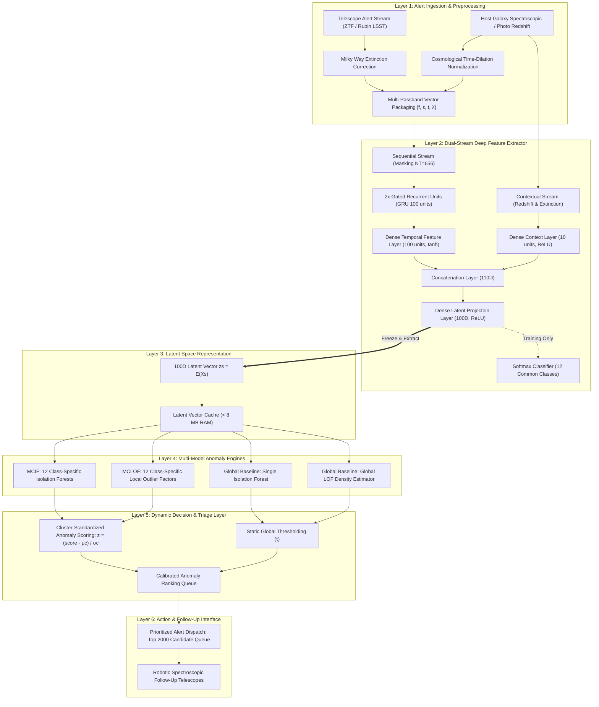

# Deep_Astro: Comprehensive System Architecture Guide

> **Audience**: Students, researchers, external developers, and evaluators seeking an end-to-end understanding of the Deep_Astro system architecture, dataflow, and algorithmic components.

---

## 1. High-Level Concept: The Anomaly Detection Dilemma

### 1.1 The Plain-English Analogy
Imagine an automated airport scanner designed to recognize 12 standard items (suitcases, laptops, shoes, water bottles). When a passenger brings a completely unknown, suspicious metallic device, a standard machine learning classifier is forced to label it as one of the 12 items (e.g., "92% sure it is a laptop"). 

In time-domain astronomy, telescope alert systems face the identical problem:
* Sky surveys (ZTF, Rubin Observatory/LSST) detect millions of explosive events.
* Standard models force every detection into known classes (e.g., standard Type Ia Supernovae).
* The rarest, most transformative scientific discoveries (kilonovae from neutron star collisions, pair-instability super-explosions, exotic calcium transients) are misclassified as routine events and lost forever.

### 1.2 The Deep_Astro Solution
Deep_Astro repurposes the **penultimate internal layer of a deep neural network** as an astronomical feature space, and combines it with **Multi-Class Anomaly Detectors** and **Dynamic Thresholding** to flag events that deviate from all known cosmic behaviors.

---

## 2. End-to-End System Flowchart



---

## 3. Deep Dive into System Layers

### Layer 1: Ingestion & Telemetry Preprocessing
* **Multi-Passband Sequential Representation**: Conventional models require light-curve interpolation (linear or Gaussian processes), which creates artifacts when observations are sparse. Deep_Astro passes each measurement directly:
  $$X_{sj} = [f_{sj}, \epsilon_{sj}, t_{sj}, \lambda_p]$$
  where $f_{sj}$ is flux scaled by 500, $\epsilon_{sj}$ is measurement uncertainty, $t_{sj}$ is time relative to trigger scaled to $[0, 1]$, and $\lambda_p$ is central passband wavelength ($g=0.4827\,\mu\text{m}, r=0.6233\,\mu\text{m}$).
* **Time-Dilation Correction**: Times are adjusted to the rest frame via $t = \frac{(T_{\text{obs}} - T_{\text{trigger}}) + 30}{100(1 + z)}$.
* **Zero-Padding & Masking**: Sequences are padded to maximum length $N_T = 656$. The neural network Masking layer ignores padded entries during backpropagation and inference.

---

### Layer 2: Dual-Stream Deep GRU Feature Extractor
* **Why GRU over LSTM?**: Gated Recurrent Units (GRU) contain fewer parameters than Long Short-Term Memory (LSTM) cells, training faster while achieving equal or superior classification and anomaly discrimination on irregularly sampled time series.
* **Contextual Fusion**: Galactic dust extinction $E(B-V)$ and host galaxy redshift $z$ are fused with the temporal features via a dedicated 10-neuron feedforward branch.
* **Repurposing Classifier as Encoder**: The network is trained on 12 common transient classes. Once trained, the final 12-way softmax layer is discarded, and the penultimate 100-neuron dense layer is retained as the feature encoder $E(X_s)$.

---

### Layer 3: Latent Space Geometry & Embedding Caching
* **Compression Factor**: A raw light curve with 656 timesteps and 4 features contains 2,624 float values. The encoder compresses this by **96.2%** into 100 numbers ($z_s \in \mathbb{R}^{100}$).
* **Clustering Property**: Because the encoder was trained to classify transients, latent representations of identical classes cluster together tightly (e.g., SNIa forms a dense sphere; SLSN-I forms an elongated cluster).
* **Memory Safety**: 20,000 objects in this latent space occupy only **~8 MB of RAM**, allowing real-time processing on standard laptops without memory exhaustion.

---

### Layer 4: Multi-Model Anomaly Detection Engine
Deep_Astro benchmarks four distinct anomaly architectures:
1. **Multi-Class Isolation Forest (MCIF)**:
   - Fits 12 independent Isolation Forests ($I_1, \dots, I_{12}$), one per common transient class.
   - Anomaly score: $A(z_s) = \min_c (-I_c(z_s))$.
   - If an object is typical of *at least one* common class, its minimum score is low. If it deviates from *all* known classes, it receives a high score.
2. **Multi-Class Local Outlier Factor (MCLOF)**:
   - Fits 12 independent LOF models, computing local reachability density against class-specific nearest neighbors.
   - Robust to non-spherical clusters and multi-density manifolds.
3. **Global Isolation Forest**:
   - Single forest trained on the pooled latent space across all classes (baseline).
4. **Global Local Outlier Factor**:
   - Single global density estimator across all common classes (baseline).

---

### Layer 5: Dynamic / Class-Conditioned Decision Layer
* **The CaRT Problem**: Subtle anomalies like Calcium-Rich Transients (CaRTs) closely resemble core-collapse supernovae in $g$ and $r$ bands, yielding anomaly scores of $-0.05$ (close to normal core-collapse SNe at $-0.07$), whereas Kilonovae reach $+0.08$. A uniform static threshold either misses CaRTs or creates thousands of false alarms.
* **Cluster Standardization**:
  $$z_{\text{calibrated}} = \frac{-I_{c^*}(z_s) - \mu_{c^*}}{\sigma_{c^*}} \quad \text{where } c^* = \arg\min_c (-I_c(z_s))$$
  Standardizes anomaly scores by the mean and variance of the closest class cluster, equalizing detection sensitivity across dense and diffuse classes.

---

## 4. Sequence Diagram: Lifecycle of an Alert

```mermaid
sequenceDiagram
    autonumber
    participant T as Survey Telescope
    participant P as Preprocessing & Masking
    participant E as Deep GRU Encoder
    participant A as MCIF / MCLOF Engines
    participant D as Dynamic Thresholding
    participant Q as Alert Queue / Follow-Up

    T->>P: Send raw alert [flux, error, MJD, filter] + host [z, E(B-V)]
    P->>P: Correct extinction & time dilation; pad to NT=656
    P->>E: Pass structured tensors [lc_input, context_input]
    E->>E: Forward pass through GRU layers & concatenate
    E->>A: Output 100D latent vector zs
    A->>A: Evaluate distance/isolation across all 12 class detectors
    A->>D: Return multi-class score matrix [-I1(zs), ..., -I12(zs)]
    D->>D: Compute cluster-standardized z-score against closest cluster
    alt Score > Dynamic Threshold (or Top 2000 Candidate)
        D->>Q: Flag as High-Priority Rare Cosmic Candidate
        Q->>T: Dispatch spectroscopic follow-up trigger
    else Normal Event
        D->>Q: Archive as known common transient
    end
```

---

## 5. Source Code Mapping

| Architectural Component | Source Code File | Primary Class / Function |
| :--- | :--- | :--- |
| **Ingestion & Data Preparation** | `data/README.md` & `astromcad` | Sequential array builder |
| **GRU Feature Extractor** | [`src/models/encoder.py`](file:///c:/Users/91948/Desktop/Deep_Astro/src/models/encoder.py) | `build_transient_encoder`, `extract_latent_space` |
| **MCIF & MCLOF Detectors** | [`src/anomaly/detectors.py`](file:///c:/Users/91948/Desktop/Deep_Astro/src/anomaly/detectors.py) | `MultiClassIsolationForest`, `MultiClassLOF` |
| **Global Baselines** | [`src/anomaly/detectors.py`](file:///c:/Users/91948/Desktop/Deep_Astro/src/anomaly/detectors.py) | `GlobalIsolationForest`, `GlobalLOF` |
| **Dynamic Thresholding** | [`src/thresholding/adaptive.py`](file:///c:/Users/91948/Desktop/Deep_Astro/src/thresholding/adaptive.py) | `ClusterStandardizedScorer`, `EmpiricalQuantileNormalizer` |
| **Observational Stress Tests** | [`src/stress_test/degradations.py`](file:///c:/Users/91948/Desktop/Deep_Astro/src/stress_test/degradations.py) | `simulate_cadence_dropouts`, `simulate_photometric_noise` |
| **Performance Evaluation** | [`src/evaluation/metrics.py`](file:///c:/Users/91948/Desktop/Deep_Astro/src/evaluation/metrics.py) | `compute_auroc`, `compute_aucpr`, `compute_recall_at_budget` |
| **End-to-End Pipeline Runner** | [`experiments/run_benchmark.py`](file:///c:/Users/91948/Desktop/Deep_Astro/experiments/run_benchmark.py) | `run_benchmark` |

---

## 6. Computational Performance & Scaling

* **Inference Latency**:
  - GRU Encoding: $\sim 1.8\text{ ms}$ per alert on standard laptop CPU.
  - MCIF Scoring: $\sim 0.3\text{ ms}$ per 100D vector across 12 trees.
  - Total latency: **$< 2.5\text{ ms}$ per candidate**, well within the real-time budget for large-scale alert brokers.
* **Memory Footprint**:
  - Entire runtime memory during batch evaluation: **$< 250\text{ MB}$**.
